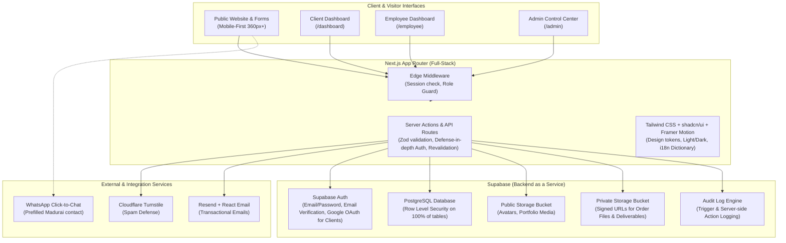
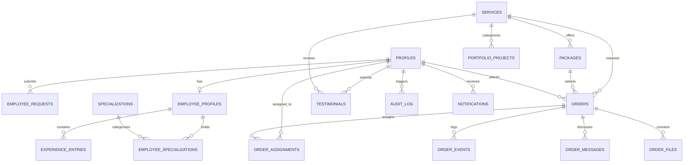

# Orvane: Implementation Plan

> **Project**: Orvane — Production-ready Website & Web App  
> **Studio**: Student-founded Freelance Studio in Madurai, Tamil Nadu, India  
> **Target Audience**: Small businesses, clinics, coaching centres, restaurants, shops, and startups across Madurai, Tamil Nadu, India, and remote international clients.  
> **Currency**: Indian Rupees (₹) | **Tone**: Confident, friendly, plain English.

---

## 1. System Architecture Overview



### Core Architecture Highlights
1. **Next.js App Router with Strict TypeScript**:
   - Zero-client secrets architecture: all mutations, Supabase admin operations, and third-party API keys (Resend, Turnstile Secret) execute exclusively on the server in Server Actions or Route Handlers.
   - High-performance caching and on-demand revalidation: public pages utilize ISR/tag-based revalidation (`revalidatePath`, `revalidateTag`), providing sub-100ms response times while immediately reflecting admin CMS edits within seconds.
2. **Supabase Layered Security**:
   - Postgres with strict Row Level Security (RLS) on **every** table.
   - Auth metadata is never trusted for authorization; roles are stored in a dedicated `profiles` table guarded by Postgres RLS and database triggers.
   - Storage segregation: `orvane-public` for public images (team photos, project showcases) with Next.js image optimization; `orvane-vault` (private) with time-limited signed URLs for project briefs, client reference materials, and work deliverables.
3. **Spam & Abuse Defense**:
   - Cloudflare Turnstile verification on all public submissions (Contact, Waitlist, Join Team).
   - Database-backed sliding-window rate limiter via Postgres atomic RPC, avoiding external paid cache dependencies while ensuring bulletproof abuse prevention.
4. **Localization (i18n) Foundation**:
   - Interface text centralized in typed dictionary modules (`src/lib/i18n/`), establishing an immediate baseline for English and enabling a seamless drop-in of Tamil (`ta-IN`) localization without rewriting UI components.

---

## 2. Complete Relational Data Model

All primary keys use UUIDv4 (`gen_random_uuid()`). All tables include `created_at` and `updated_at` timestamps with automatic trigger updates.



### Table Definitions & Constraints

#### 1. `profiles`
Central user registry linked to `auth.users`.
- `id` (uuid, PK, references `auth.users(id)` on delete cascade)
- `email` (text, not null, unique)
- `full_name` (text, not null)
- `phone` (text, nullable)
- `avatar_url` (text, nullable)
- `role` (enum: `'client'`, `'pending_employee'`, `'employee'`, `'admin'`, default `'client'`, not null)
- `status` (enum: `'active'`, `'pending'`, `'suspended'`, `'rejected'`, default `'active'`, not null)
- `created_at` (timestamptz, default now())
- `updated_at` (timestamptz, default now())

#### 2. `employee_requests`
Queue for "Join the team" applicants.
- `id` (uuid, PK)
- `user_id` (uuid, FK `profiles.id`, unique)
- `portfolio_url` (text, nullable)
- `resume_url` (text, nullable)
- `skills` (text[], not null)
- `cover_note` (text, not null)
- `status` (enum: `'pending'`, `'approved'`, `'rejected'`, default `'pending'`, not null)
- `reviewed_by` (uuid, nullable, FK `profiles.id`)
- `rejection_reason` (text, nullable)
- `reviewed_at` (timestamptz, nullable)
- `created_at` (timestamptz, default now())

#### 3. `employee_profiles`
Public portfolio profile for approved team members.
- `id` (uuid, PK)
- `user_id` (uuid, unique, FK `profiles.id` on delete cascade)
- `slug` (text, unique, not null)
- `designation` (text, not null) — e.g. "Lead Frontend Engineer", "Motion Designer"
- `bio` (text, not null)
- `availability_status` (enum: `'available'`, `'busy'`, `'unavailable'`, default `'available'`)
- `is_featured` (boolean, default false)
- `display_order` (integer, default 0)
- `is_published` (boolean, default true)
- `github_url` (text, nullable)
- `linkedin_url` (text, nullable)
- `twitter_url` (text, nullable)
- `website_url` (text, nullable)
- `created_at` (timestamptz, default now())
- `updated_at` (timestamptz, default now())

#### 4. `specializations` & `employee_specializations`
- `specializations`: `id` (uuid, PK), `name` (text, unique), `slug` (text, unique)
- `employee_specializations`: `employee_profile_id` (uuid, FK), `specialization_id` (uuid, FK), composite PK

#### 5. `experience_entries`
Timeline entries for employee public profiles.
- `id` (uuid, PK)
- `employee_profile_id` (uuid, FK `employee_profiles.id` on delete cascade)
- `role` (text, not null)
- `organization` (text, not null)
- `start_date` (date, not null)
- `end_date` (date, nullable)
- `is_current` (boolean, default false)
- `description` (text, not null)
- `display_order` (integer, default 0)
- `created_at` (timestamptz, default now())

#### 6. `services`
Dynamic service catalogue (data, not code).
- `id` (uuid, PK)
- `slug` (text, unique, not null)
- `title` (text, not null)
- `short_description` (text, not null)
- `full_description` (text, not null)
- `icon_name` (text, not null)
- `is_active` (boolean, default true)
- `display_order` (integer, default 0)
- `created_at` (timestamptz, default now())
- `updated_at` (timestamptz, default now())

#### 7. `packages`
Tiered service offerings ("Starting from ₹").
- `id` (uuid, PK)
- `service_id` (uuid, FK `services.id` on delete cascade)
- `name` (text, not null) — e.g. "Starter Brand Website", "Reels Starter Pack"
- `slug` (text, unique, not null)
- `price_inr` (numeric(10,2), not null)
- `delivery_time_days` (integer, not null)
- `features` (jsonb, not null) — e.g. `["5 Pages", "Responsive UI", "SEO Basics"]`
- `is_popular` (boolean, default false)
- `is_active` (boolean, default true)
- `display_order` (integer, default 0)
- `created_at` (timestamptz, default now())

#### 8. `portfolio_projects` & `project_collaborators`
- `portfolio_projects`: `id` (uuid, PK), `title` (text), `slug` (text, unique), `service_id` (uuid, FK `services.id`), `client_name` (text), `thumbnail_url` (text), `gallery_urls` (text[]), `challenge` (text), `solution` (text), `outcome_metrics` (jsonb), `project_url` (text, nullable), `is_featured` (boolean, default false), `display_order` (integer, default 0), `created_at` (timestamptz)
- `project_collaborators`: `project_id` (uuid, FK), `employee_profile_id` (uuid, FK), composite PK

#### 9. `testimonials`
- `id` (uuid, PK)
- `client_name` (text, not null)
- `client_role_company` (text, not null) — e.g. "Founder, Meenakshi Sweets"
- `avatar_url` (text, nullable)
- `rating` (smallint, check `rating between 1 and 5`, default 5)
- `content` (text, not null)
- `service_id` (uuid, nullable, FK `services.id`)
- `order_id` (uuid, nullable, FK `orders.id`)
- `is_approved` (boolean, default false) — requires admin moderation before publishing
- `is_featured` (boolean, default false)
- `display_order` (integer, default 0)
- `created_at` (timestamptz, default now())

#### 10. `faqs`
- `id` (uuid, PK)
- `category` (text, not null) — e.g. "General", "Web Development", "Payments"
- `question` (text, not null)
- `answer` (text, not null)
- `display_order` (integer, default 0)
- `is_active` (boolean, default true)
- `created_at` (timestamptz, default now())

#### 11. `orders`
The central commercial and operational entity.
- `id` (uuid, PK)
- `order_number` (text, unique, not null) — e.g. `ORV-2026-0001`
- `client_id` (uuid, not null, FK `profiles.id`)
- `service_id` (uuid, not null, FK `services.id`)
- `package_id` (uuid, nullable, FK `packages.id`)
- `preferred_employee_id` (uuid, nullable, FK `profiles.id`)
- `title` (text, not null)
- `project_brief` (text, not null)
- `budget_min_inr` (numeric(10,2), not null)
- `budget_max_inr` (numeric(10,2), not null)
- `target_deadline` (date, not null)
- `preferred_contact_method` (text, not null) — "email" | "whatsapp" | "phone"
- `status` (enum: `'submitted'`, `'in_review'`, `'quote_sent'`, `'accepted'`, `'in_progress'`, `'awaiting_feedback'`, `'delivered'`, `'closed'`, `'cancelled'`, default `'submitted'`)
- `quote_amount_inr` (numeric(10,2), nullable)
- `quote_terms` (text, nullable)
- `payment_status` (enum: `'unbilled'`, `'quote_pending'`, `'invoiced'`, `'partially_paid'`, `'paid_in_full'`, `'refunded'`, default `'unbilled'`)
- `internal_notes` (text, nullable) — strictly never exposed to client
- `created_at` (timestamptz, default now())
- `updated_at` (timestamptz, default now())

#### 12. `order_assignments`
- `order_id` (uuid, FK `orders.id` on delete cascade)
- `employee_id` (uuid, FK `profiles.id`)
- `assigned_by` (uuid, FK `profiles.id`)
- `assigned_at` (timestamptz, default now())
- Primary Key: `(order_id, employee_id)`

#### 13. `order_events`
Audit trail of status changes, quotes, and delivery milestones.
- `id` (uuid, PK)
- `order_id` (uuid, FK `orders.id` on delete cascade)
- `actor_id` (uuid, FK `profiles.id`)
- `event_type` (text, not null)
- `previous_value` (text, nullable)
- `new_value` (text, not null)
- `notes` (text, nullable)
- `is_internal_only` (boolean, default false)
- `created_at` (timestamptz, default now())

#### 14. `order_messages`
Project collaboration message thread.
- `id` (uuid, PK)
- `order_id` (uuid, FK `orders.id` on delete cascade)
- `sender_id` (uuid, FK `profiles.id`)
- `content` (text, not null)
- `attachments` (jsonb, default `'[]'::jsonb`)
- `is_read` (boolean, default false)
- `created_at` (timestamptz, default now())

#### 15. `order_files`
Secure project files in private storage bucket.
- `id` (uuid, PK)
- `order_id` (uuid, FK `orders.id` on delete cascade)
- `uploader_id` (uuid, FK `profiles.id`)
- `file_name` (text, not null)
- `file_size` (bigint, not null)
- `mime_type` (text, not null)
- `storage_path` (text, not null)
- `file_category` (enum: `'client_reference'`, `'deliverable'`, `'invoice'`, `'feedback'`)
- `is_deliverable` (boolean, default false)
- `created_at` (timestamptz, default now())

#### 16. `contact_messages`
- `id` (uuid, PK)
- `name` (text, not null)
- `email` (text, not null)
- `phone` (text, nullable)
- `service_id` (uuid, nullable, FK `services.id`)
- `message` (text, not null)
- `is_handled` (boolean, default false)
- `handled_by` (uuid, nullable, FK `profiles.id`)
- `handled_at` (timestamptz, nullable)
- `ip_hash` (text, not null)
- `created_at` (timestamptz, default now())

#### 17. `waitlist_entries`
Hardware & IoT waitlist.
- `id` (uuid, PK)
- `email` (text, not null)
- `full_name` (text, not null)
- `company_or_project` (text, nullable)
- `interest_details` (text, not null)
- `is_handled` (boolean, default false)
- `created_at` (timestamptz, default now())

#### 18. `site_settings`
Key-value configuration for studio phone, WhatsApp, socials, and legal text.
- `key` (text, PK)
- `value` (jsonb, not null)
- `updated_by` (uuid, FK `profiles.id`)
- `updated_at` (timestamptz, default now())

#### 19. `audit_log`
Comprehensive tamper-evident log for admin actions.
- `id` (uuid, PK)
- `actor_id` (uuid, nullable, FK `profiles.id`)
- `action` (text, not null) — e.g. `EMPLOYEE_APPROVED`, `QUOTE_ISSUED`, `CONTENT_UPDATED`
- `entity_type` (text, not null)
- `entity_id` (text, not null)
- `metadata` (jsonb, default `'{}'::jsonb`)
- `ip_address` (text, nullable)
- `created_at` (timestamptz, default now())

#### 20. `notifications`
- `id` (uuid, PK)
- `user_id` (uuid, FK `profiles.id` on delete cascade)
- `title` (text, not null)
- `message` (text, not null)
- `link` (text, nullable)
- `is_read` (boolean, default false)
- `created_at` (timestamptz, default now())

#### 21. `rate_limits`
Database sliding-window counter table.
- `id` (uuid, PK)
- `key` (text, not null) — hash of IP/User + action endpoint
- `counter` (integer, default 1)
- `window_start` (timestamptz, default now())
- `expires_at` (timestamptz, not null)
- Index on `(key, expires_at)`

---

## 3. Row Level Security (RLS) Policy Matrix

| Table | Anonymous Visitor | Authenticated Client | Approved Employee | Admin |
| :--- | :--- | :--- | :--- | :--- |
| `profiles` | Read public employee profiles only | Read/update own record | Read own record & colleagues | Full access (read/write all) |
| `employee_requests` | None (insert via secure action) | None | Read own request | Full access (approve/reject) |
| `employee_profiles` | Read published & active only | Read published & active only | Read/update own profile only | Full access (publish/unpublish) |
| `experience_entries` | Read for published profiles | Read for published profiles | Read/insert/update/delete own | Full access |
| `services` | Read active | Read active | Read active | Full access |
| `packages` | Read active | Read active | Read active | Full access |
| `portfolio_projects` | Read all published | Read all published | Read all published | Full access |
| `testimonials` | Read approved only | Read approved + insert own review | Read approved | Full access (approve/hide) |
| `faqs` | Read active | Read active | Read active | Full access |
| `orders` | None | Read & insert own orders; cannot alter internal notes or quote terms | Read only assigned orders; status transitions within allowed steps | Full access |
| `order_assignments` | None | Read assignments for own orders | Read assignments for own orders | Full access |
| `order_events` | None | Read non-internal events for own orders | Read events for assigned orders | Full access |
| `order_messages` | None | Read/insert messages for own orders | Read/insert messages for assigned orders | Full access |
| `order_files` | None | Read/upload files for own orders; cannot alter file status | Read files & upload deliverables for assigned orders | Full access |
| `contact_messages` | Insert only (with Turnstile) | Insert only | None | Full access |
| `waitlist_entries` | Insert only (with Turnstile) | Insert only | None | Full access |
| `site_settings` | Read public keys | Read public keys | Read public keys | Full access |
| `audit_log` | None | None | None | Read only |
| `notifications` | None | Read/update own | Read/update own | Read/update own |

---

## 4. Route Map & Navigation Architecture

### Public Routes (`/(public)`)
- `/`: Home page (Promise, Primary CTA, Featured Work, Dynamic Services, 4-step Process, Social Proof, Featured Team, Mini FAQ, Closing CTA)
- `/services`: All services catalogue
- `/services/[slug]`: Specific service details, included packages, process, and direct order CTA
- `/packages`: All pricing tiers ("Starting from ₹")
- `/portfolio`: Filterable showcase of client work
- `/portfolio/[slug]`: In-depth case study (Challenge, Solution, Impact metrics, Collaborator attribution)
- `/team`: Public directory of approved Orvane engineers and creators
- `/team/[slug]`: Comprehensive public profile (Bio, Specializations, Experience timeline, Works, Availability, "Request [name] for project" button)
- `/about`: Studio story, student engineering origins in Madurai, mission and ethos
- `/how-we-work`: 4-step workflow, transparency standards, communication rhythm
- `/testimonials`: Full client review directory with rating stars
- `/faq`: Searchable frequently asked questions
- `/contact`: Interactive enquiry form, WhatsApp click-to-chat, office details
- `/hardware`: Hardware & IoT "Coming Soon" showcase with waitlist registration
- `/join`: Team application portal with portfolio submission
- `/privacy`: DPDP Act-compliant privacy policy (marked draft for legal review)
- `/terms`: Client terms of service & intellectual property provisions
- `/not-found` & `/error`: Custom branded error screens

### Authentication Routes (`/(auth)`)
- `/login`: Unified credentials login + Google OAuth for clients
- `/signup`: Client registration
- `/verify-email`: Notice and token receiver
- `/forgot-password` & `/reset-password`: Self-service recovery flow
- `/awaiting-approval`: Holding page for pending employee applicants

### Client Dashboard (`/dashboard`)
- `/dashboard`: Active orders summary, status overview chips, recent messages
- `/dashboard/orders/new`: Multi-step order submission form (Service, Package/Custom, Budget ₹, Deadline, References, File upload, Preferred creator)
- `/dashboard/orders/[orderNumber]`: Order status timeline, quote & billing summary, deliverables download, real-time message thread
- `/dashboard/orders/[orderNumber]/review`: Post-delivery review submission
- `/dashboard/profile`: Contact details, password update, DPDP data export & account deletion

### Employee Dashboard (`/employee`)
- `/employee`: Active assigned projects, upcoming milestones, unread client messages
- `/employee/orders`: Filterable list of assigned projects
- `/employee/orders/[orderNumber]`: Project timeline, deliverable uploader, client communication thread, progress notes
- `/employee/profile`: Interactive profile editor (Designation, Bio, Experience timeline builder, Specializations, Socials, Availability status toggle, Live mobile/desktop preview)

### Admin Dashboard (`/admin`)
- `/admin`: Studio metrics, open enquiries count, pending approvals, revenue pipeline, recent activity stream
- `/admin/employees`: Pending applicant review queue (Approve/Reject modal with custom email reason), active & suspended employee directory, email invite generator, display order manager
- `/admin/orders`: Global order ledger with status filters, employee assignment selector, manual quote editor, payment status updates, internal notes
- `/admin/inbox`: Contact inquiries and Hardware waitlist submissions with "Mark as Handled" workflow
- `/admin/content`: Service manager, package pricing editor, portfolio/case-study publisher, testimonial approvals, FAQ builder, site settings (WhatsApp, socials, studio phone/email)
- `/admin/audit`: Filterable tamper-evident log of all admin operations

---

## 5. Design System & Tokens

### Palette
```css
:root {
  /* Surface & Base */
  --bg-primary: #F6F3EE;       /* Warm Studio Cream */
  --bg-card: #FFFFFF;          /* Pure Card White */
  --bg-muted: #EFECE6;         /* Subtle Neutral Tint */
  --border: #E5E0D8;           /* Warm Sand Border */
  
  /* Text & Ink */
  --text-primary: #111214;     /* Deep Studio Ink */
  --text-muted: #575A60;       /* Secondary Charcoal */
  --text-subtle: #898E96;      /* Tertiary Gray */
  
  /* Accents & Brand */
  --accent-vermilion: #C8341B; /* Signature Orvane Vermilion */
  --accent-hover: #AF2B15;     /* Darkened Accent */
  --accent-subtle: #FDF1EE;    /* Soft Tint for Pills/Borders */
  
  /* Status Semantics */
  --status-info: #0284C7;
  --status-success: #15803D;
  --status-warning: #B45309;
  --status-error: #B91C1C;
}

.dark {
  --bg-primary: #121315;       /* Deep Charcoal Ink */
  --bg-card: #1A1C1F;          /* Elevated Dark Surface */
  --bg-muted: #22252A;         /* Slate Neutral */
  --border: #2B2F36;           /* Subtle Dark Border */
  
  --text-primary: #F3F4F6;     /* Crisp Off-White */
  --text-muted: #9CA3AF;       /* Muted Body */
  --text-subtle: #6B7280;      /* Dark Subtle */
  
  --accent-vermilion: #FF4D30; /* High-Contrast Vermilion */
  --accent-hover: #E63B1E;
  --accent-subtle: #2C1814;
}
```

### Typography Hierarchy
- **Display Heading**: *Syne* / *Cabinet Grotesk* (self-hosted `@next/font`), bold, confident, editorial studio tone.
- **Body & Interface**: *Plus Jakarta Sans* / *Inter* (self-hosted `@next/font`), 16px-18px body, 1.6 line height, max 70ch reading measure.
- **Tamil Compatibility**: *Noto Sans Tamil* mapped directly into `font-tamil` fallback stack.
- **Contrast & Standards**: Strict WCAG 2.2 AA (4.5:1 for body text, 3:1 for large display and UI components). Focus rings visible on keyboard navigation (`ring-2 ring-vermilion ring-offset-2`).

### Motion Philosophy
- Framer Motion used strictly for functional, high-taste transitions (fade-in on scroll, smooth accordion toggles, modal dialogs).
- Respects `prefers-reduced-motion` at all levels.

---

## 6. Implementation Phases & Milestones

### Phase 0: Plan & Architecture Approval *(Current Step)*
- [x] Save brief to `docs/BRIEF.md`.
- [x] Configure workspace rule in `.agent/rules/orvane.md`.
- [x] Deliver implementation plan covering data model, route map, security, and design tokens.
- [ ] **Await User Review & Approval before code creation.**

---

### Phase 1: Foundation & Scaffold
- Scaffold Next.js App Router project with TypeScript, Tailwind CSS, Lucide icons, and shadcn/ui.
- Setup design tokens in Tailwind config and CSS variables (cream, ink, vermilion, light/dark mode with `next-themes`).
- Self-host fonts (display, body, and Tamil fallback).
- Build shared layout: Header with responsive mobile sheet menu, Footer with studio contact & social links, Floating WhatsApp button.
- Build baseline component library: Buttons, Inputs, Cards, Badges, Dialogs, Toasts, Status Chips.
- Build i18n text store architecture in `src/lib/i18n/`.
- Add unit test setup (Vitest) and e2e framework (Playwright).
- Run lint, type-check, take responsive screenshots (360px, 768px, 1280px), stop for review.

---

### Phase 2: Database, Authentication & Security
- Supabase SQL migrations: all 21 tables, RLS policies, trigger functions, and indexes.
- Database-backed sliding window rate limiter RPC function.
- Auth client and server helpers with `@supabase/ssr`.
- Sign-up, Login, and Password recovery flows.
- "Join the team" registration flow creating `pending_employee` records and redirecting to `/awaiting-approval`.
- Edge middleware and server action defense-in-depth route guards (`/dashboard`, `/employee`, `/admin`).
- Database seed script with `ADMIN_EMAIL` bootstrap and labelled demo content.
- Unit tests for permission logic & RLS expectations.
- Run lint, type-check, verify auth flows, stop for review.

---

### Phase 3: Dynamic Public Website
- Build all public pages with database-driven content:
  - Home (Hero, Dynamic Services, Featured Work, Process, Social Proof, Featured Team, FAQ, CTA).
  - Services directory and `/services/[slug]` detail page with dynamic package cards.
  - Packages page with starting prices in ₹.
  - Portfolio grid with service filtering and `/portfolio/[slug]` case study layout.
  - About, How We Work, Testimonials, FAQ.
  - Hardware & IoT page with waitlist registration form.
  - Contact page with Turnstile spam protection, form validation, email trigger, and WhatsApp link.
  - Privacy Policy and Terms of Service (DPDP Act draft).
  - 404 and Error pages.
- On-demand ISR revalidation hooks.
- Mobile audit at 360px width.
- Stop for review.

---

### Phase 4: Team Directory & Public Profiles
- Team index page (`/team`) showing active approved members with designation, specializations, and availability badges.
- Individual member profile page (`/team/[slug]`): photo, bio, specializations, experience timeline, selected work, social links, and "Request [name] for your project" CTA.
- Employee Profile Editor in `/employee/profile`: form to edit designation, bio, experience entries (CRUD + order), specializations, availability, with live desktop & mobile preview.
- Admin controls to publish/unpublish, feature, and reorder team profiles.
- Stop for review.

---

### Phase 5: Client Order Lifecycle
- Client Dashboard (`/dashboard`) orders overview with status chips and empty states.
- Multi-step New Order Request form: service selector, package or custom scope, brief, budget range in ₹, target deadline, reference file upload to private bucket, preferred employee.
- Order Detail page (`/dashboard/orders/[orderNumber]`):
  - Visual status timeline (Submitted -> In review -> Quote sent -> Accepted -> In progress -> Awaiting feedback -> Delivered -> Closed).
  - Secure signed URL deliverables viewer and download section.
  - Real-time client-to-team messaging thread.
  - Quote display and payment status tracker.
- Post-delivery review submission modal.
- Client profile and notification settings; DPDP data export & account deletion.
- Transactional email dispatch via Resend (Contact received, Order received, Status updated).
- Stop for review.

---

### Phase 6: Employee & Admin Dashboards
- Employee Dashboard (`/employee`):
  - Assigned orders list with deadline indicators.
  - Status progression actions (within permitted transitions).
  - Deliverable file uploader with category tags.
  - Team messaging interface.
- Admin Dashboard (`/admin`):
  - Operational metrics overview.
  - Employee approval queue: approve, reject with custom email reason, suspend, reinstate, remove, invite by email.
  - Global Order Manager: filter by status/service, assign/reassign team members, send quote with terms, update payment status, manage private internal notes.
  - Inbox: contact enquiries & hardware waitlist entries with handled flags.
  - Content CMS: CRUD for services, packages, portfolio projects, testimonials (approve/hide), FAQs, site settings.
  - Audit log explorer with filtering.
- Stop for review.

---

### Phase 7: Hardening, SEO, Performance & Testing
- Automated Playwright end-to-end tests:
  1. Client sign-up -> Place order -> Order detail view.
  2. Applicant join team -> Admin approval flow -> Employee login -> Profile edit.
  3. Contact form submission with spam protection.
- Unit tests for validation, rate limiting, and permission matrices.
- Security headers (CSP, HSTS, X-Frame-Options, X-Content-Type-Options, Referrer-Policy).
- SEO audit: Dynamic Open Graph images, JSON-LD schemas (`ProfessionalService` with Madurai locality, `Person` for team members), `sitemap.xml`, `robots.txt`.
- Performance check: Lighthouse 90+ mobile validation, image optimization, font display optimization.
- Stop for review.

---

### Phase 8: Deployment & Launch Readiness
- Comprehensive `README.md`: local development, environment variables, Supabase setup & migrations, seed scripts, deploying to Vercel and Netlify.
- `docs/ARCHITECTURE.md` (system internals, data flows, security boundaries).
- `docs/CONTENT-GUIDE.md` (admin guide for managing services, projects, pricing, and team).
- Launch checklist and production smoke test.
- Final review.

---

## 7. Risks & Mitigation Strategies

| Risk | Impact | Mitigation Strategy |
| :--- | :--- | :--- |
| **Unauthorized role elevation** | High | Roles live strictly in a database table guarded by RLS. No role fields in client JWTs or browser-editable metadata. Database triggers prevent self-promotion. Middleware + Server Action dual-layer guards. |
| **Exposure of sensitive client files** | High | Use Supabase private storage bucket with signed URLs expiring in 15 minutes. Storage RLS policies verify user assignment before granting URL generation. |
| **Spam attacks on public forms** | Medium | Cloudflare Turnstile token validation on server side + database-backed IP sliding window rate limiting. |
| **Layout shift & mobile breakage** | Medium | All tables transform into responsive card stacks below 768px. Explicit image dimensions and blur placeholders. Verified at 360px viewport. |
| **Data model rigidity when adding services** | Medium | Services and packages are completely decoupled from code. Adding a service row instantly updates navigation, order forms, and portfolio filters. |

---

## 8. Open Questions & Recommendations

1. **Rate Limiting Approach**:
   - *Options*: (A) External Redis (Upstash) vs. (B) Database-backed Postgres sliding-window table via RPC.
   - *Recommendation*: **Option B (Postgres table + RPC)**. It is 100% free, requires no external service account or billing, works across both Vercel and Netlify, and maintains transactional consistency with Supabase.
2. **First Admin Provisioning**:
   - *Recommendation*: A dedicated seed script `npm run db:seed` checks for `ADMIN_EMAIL` in `.env.local` and creates or elevates the admin user automatically.
3. **Email Provider During Development**:
   - *Recommendation*: Resend SDK in test mode / console fallback if `RESEND_API_KEY` is not provided locally, ensuring full developer experience without blocking on API keys.
